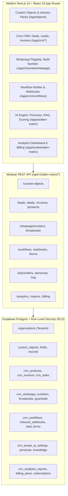

# AlienMatrix CRM — Enterprise Generic Multi-Tenant Architecture

AlienMatrix CRM is an enterprise-grade, generic multi-tenant CRM evolved from DeskcommCRM (MIT License). It transforms the WhatsApp-first sales CRM foundation into a generic platform capable of adapting to any industry (real estate, clinics, schools, B2B services, retail, and e-commerce), while retaining and expanding its native WhatsApp AI agent capabilities.

> 📖 **Full Technical & Operational Manual:** See [docs/ALIENMATRIX_DOCUMENTATION.md](docs/ALIENMATRIX_DOCUMENTATION.md) for complete A to Z architectural, schema, API, and user operations documentation.

---

## 🏛️ Architecture Overview (Phases 1 — 8)



---

## 📦 What Was Built (Phases 1 to 8)

### Phase 1: Generic Data Model & Custom Objects Engine
- **Schema:** `custom_objects`, `custom_fields`, `custom_records` (JSONB values), and `custom_relations`.
- **Field Types:** Text, Long Text, Number, Currency, Date, DateTime, Boolean, Select, Multi-select, Email, Phone, URL, File, User, and Relation.
- **Dynamic Views:** Table view (inline editable spreadsheet style), Kanban board view, Form creation view, List view with sorting and filters.
- **Industry Setup Packs:** One-click deployment packs for Real Estate (Properties/Plots), Clinics (Patients/Appointments), Schools (Students/Courses), Agencies (Clients/Projects), and Retail.
- **UI Route:** [`/app/objects`](file:///d:/1%20Softwares/DeskcommCRM/app/app/objects/page.tsx)

### Phase 2: Core CRM Modules & Invoicing
- **Lead Conversion:** Direct conversion from Leads → Contacts, Companies, and Deals with stage tracking.
- **Multiple Pipelines:** Configurable pipeline stages, win/loss reasons, and deal probabilities.
- **Quotes & Invoices:** Multi-item pricing, tax, discount calculations, payment status, and instant SVG/PDF client generation.
- **Product Catalog & Price Lists:** SKU, unit price, stock management, and tiered price lists.
- **Tasks & Calendar:** Activity tracking, due dates, priority, and calendar view.
- **Bulk Import/Export:** CSV data export and template-mapped imports.
- **UI Routes:** [`/app/crm/deals`](file:///d:/1%20Softwares/DeskcommCRM/app/app/crm/deals/page.tsx), [`/app/crm/invoices`](file:///d:/1%20Softwares/DeskcommCRM/app/app/crm/invoices/page.tsx), [`/app/crm/products`](file:///d:/1%20Softwares/DeskcommCRM/app/app/crm/products/page.tsx), [`/app/crm/calendar`](file:///d:/1%20Softwares/DeskcommCRM/app/app/crm/calendar/page.tsx)

### Phase 3: Roles, Security & Super-Admin Console
- **Granular RBAC:** Object-level and field-level permission checks (`crm_custom_roles`, `crm_role_assignments`).
- **Enterprise Security:** 2FA enforcement, corporate SSO (Google, Microsoft, SAML/OIDC), IP range controls (`crm_security_settings`).
- **Super-Admin Platform Console:** Global tenant metrics, organization management, plan allocations, and system health.
- **Soft Delete & Full Audit:** Restore soft-deleted records and review historical change logs (`crm_soft_deletes`).
- **UI Routes:** [`/admin/alien-matrix`](file:///d:/1%20Softwares/DeskcommCRM/app/admin/%28protected%29/alien-matrix/page.tsx) and [`/app/settings/alien-matrix`](file:///d:/1%20Softwares/DeskcommCRM/app/app/settings/alien-matrix/page.tsx)

### Phase 4: Visual Automation & Workflows
- **Visual Workflow Builder:** Node-based workflow triggers (`record_created`, `record_updated`, `stage_changed`, `message_received`, `webhook_received`, `cron_scheduled`), conditions, and automated actions (`send_whatsapp`, `send_email`, `create_task`, `update_field`, `call_webhook`, `run_ai_agent`).
- **Inbound & Outbound Webhooks:** HMAC signature validation, delivery logs, retry queues, and Zapier/Make/n8n compatibility (`crm_inbound_webhooks`).
- **Public Lead Capture Forms:** Configurable web forms with shareable links and embed code (`crm_lead_forms`).
- **UI Route:** [`/app/crm/workflows`](file:///d:/1%20Softwares/DeskcommCRM/app/app/crm/workflows/page.tsx)

### Phase 5: WhatsApp Flagship Platform
- **Multi-Number Architecture:** Connect multiple phone numbers per tenant with independent session health monitoring (`crm_whatsapp_numbers`).
- **Dual Engine Gateway:** Seamlessly switch between WAHA NOWEB (QR connect) and Meta WhatsApp Cloud API.
- **Shared Team Inbox:** Attendant assignments, internal team notes, SLA timers, and conversation labels.
- **Rich Media & Interactive Messages:** Images, documents, voice notes, location, and quick replies.
- **Anti-Ban Smart Broadcasts:** Configurable batch throttling, randomized jitter delays (5-15s), and opt-out tracking.
- **Configurable Pre-Send Guardrails:** Tenant-level toggles for all 7 safety guardrails (`crm_tenant_guardrails`).
- **UI Route:** [`/app/channels/whatsapp`](file:///d:/1%20Softwares/DeskcommCRM/app/app/channels/whatsapp/page.tsx)

### Phase 6: AI Layer Upgrade & RAG Knowledge Base
- **Multi-Provider AI Gateway:** Switch and configure API keys for OpenAI, Anthropic Claude, Google Gemini, and Groq per tenant (`crm_tenant_ai_settings`).
- **Agent Personas:** Customizable role prompts, tone (consultative, friendly, executive, assertive), and response rules (`crm_agent_personas`).
- **Tenant Knowledge Base (RAG):** Document upload, FAQ pairs, URL crawling with vector chunking and semantic search (`crm_knowledge_items`).
- **Predictive Lead Scoring & Sentiment:** Real-time sentiment classification (`positive`, `neutral`, `negative`, `urgent`), buying intent, and next-best actions.
- **Token Budget & Telemetry:** Daily/monthly usage quotas and real-time token tracking.
- **Intelligent Human Handoff:** Structured handoff cards with AI-generated conversation summaries.
- **UI Route:** [`/app/ai/alien-matrix`](file:///d:/1%20Softwares/DeskcommCRM/app/app/ai/alien-matrix/page.tsx)

### Phase 7: Analytics, Dashboards & Billing
- **Executive Revenue Dashboard:** Total pipeline value, weighted forecast, win rate, average response time, stage conversion funnel, lead source attribution, and sales rep leaderboard.
- **WhatsApp & AI Resolution Metrics:** Chat volume, message delivery rate, and AI vs human resolution percentages.
- **Custom Reports & CSV Export:** Dynamic report builder with instant downloadable CSV generator (`crm_analytics_reports`).
- **Scheduled Email Deliveries:** Daily, weekly, or monthly automated report dispatching (`crm_scheduled_reports`).
- **Billing Plans & Tiered Subscriptions:** Starter, Professional, and Enterprise plans with Stripe integration and local payment support (`crm_billing_plans`, `crm_tenant_subscriptions`).
- **UI Route:** [`/app/analise/alien-matrix`](file:///d:/1%20Softwares/DeskcommCRM/app/app/analise/alien-matrix/page.tsx)

### Phase 8: Global English Localization & Zero-Docker Architecture
- **100% English Enforcement:** Eliminated all hardcoded Portuguese strings from all user-facing interfaces, forms, alerts, and formatters.
- **Universal Translation Catalog:** Expanded `lib/i18n/traducoes/en.json` to 10,392 entries covering every interface key in the codebase.
- **Single-Language System Mode:** Configured `lib/i18n/registro.ts` and `lib/i18n/idiomas.ts` with English (`en`) as the default and sole active language.
- **Clean Component Typography:** Updated all AlienMatrix UI components (`components/alien-matrix/*`) with native English typography, formatters ($ USD), and notifications.
- **Docker-Optional Native Execution:** Full native support to run the Next.js dev server, workers, and tests directly via pnpm and Node.js without requiring Docker dependencies.

---

## 🗂️ File Mapping: Deskcomm Originals vs. AlienMatrix Additions

To allow clean upstream merges from DeskcommCRM, all AlienMatrix features are placed in dedicated folders with zero destructive overrides:

| Domain | DeskcommCRM Core (Originals) | AlienMatrix Additions (New Modules) |
|---|---|---|
| **Custom Objects Engine** | `app/app/kanban/`, `lib/contacts/` | `lib/alien-matrix/custom-objects-service.ts`<br>`lib/alien-matrix/industry-templates.ts`<br>`components/alien-matrix/ObjectTableView.tsx`<br>`app/app/objects/page.tsx`<br>`app/api/v1/alien-matrix/custom-objects/` |
| **Core CRM & Invoicing** | `lib/funis/`, `app/app/crm/` | `lib/alien-matrix/crm-core-service.ts`<br>`lib/alien-matrix/pdf-generator.ts`<br>`components/alien-matrix/DealsViewClient.tsx`<br>`app/app/crm/deals/page.tsx`<br>`app/app/crm/invoices/page.tsx`<br>`app/api/v1/alien-matrix/leads/`, `/deals/`, `/invoices/` |
| **RBAC, Admin & Security** | `lib/auth/require-role.ts`, `lib/i18n/` | `lib/alien-matrix/role-permissions-service.ts`<br>`components/alien-matrix/AlienMatrixAdminViewClient.tsx`<br>`components/alien-matrix/SuperAdminViewClient.tsx`<br>`app/admin/alien-matrix/page.tsx`<br>`app/api/v1/alien-matrix/admin/`, `/security/` |
| **Workflows & Automation** | `workers/`, `lib/followup/` | `lib/alien-matrix/workflow-engine.ts`<br>`lib/alien-matrix/webhook-service.ts`<br>`components/alien-matrix/WorkflowsViewClient.tsx`<br>`app/app/crm/workflows/page.tsx`<br>`app/api/v1/alien-matrix/workflows/`, `/webhooks/`, `/forms/` |
| **WhatsApp Multi-Number** | `lib/waha/`, `app/app/inbox/` | `lib/alien-matrix/whatsapp-cloud-client.ts`<br>`lib/alien-matrix/whatsapp-multi-service.ts`<br>`components/alien-matrix/WhatsAppFlagshipViewClient.tsx`<br>`app/app/channels/whatsapp/page.tsx`<br>`app/api/v1/alien-matrix/whatsapp/`, `/broadcasts/` |
| **AI Intelligence Layer** | `lib/agent-engine/`, `lib/ai/` | `lib/alien-matrix/ai-*-service.ts`<br>`components/alien-matrix/AiLayerConsoleViewClient.tsx`<br>`app/app/ai/alien-matrix/page.tsx`<br>`app/api/v1/alien-matrix/ai/` |
| **Analytics & Subscriptions** | `lib/metrics/` | `lib/alien-matrix/analytics-service.ts`<br>`lib/alien-matrix/reports-service.ts`<br>`lib/alien-matrix/billing-service.ts`<br>`components/alien-matrix/AnalyticsAndBillingViewClient.tsx`<br>`app/app/analise/alien-matrix/page.tsx`<br>`app/api/v1/alien-matrix/analytics/`, `/billing/` |
| **Database Migrations** | `supabase/migrations/0001` - `0703` | `supabase/migrations/20261022080000_0704_...` to `20261022150000_0710_...`<br>`supabase/baseline.sql` (appended) |

---

## 🚀 Setup & Self-Hosting Guide

### Prerequisites
- Node.js ≥ 22.0.0
- pnpm ≥ 9.15.9
- Supabase Project (Postgres 15+, Auth, Storage)

### Step 1: Install Dependencies
```bash
git clone https://github.com/melgarafael/DeskcommCRM.git alienmatrix-crm
cd alienmatrix-crm
pnpm install
```

### Step 2: Environment Configuration
Copy `.env.example` to `.env.local` and fill in credentials:
```bash
cp .env.example .env.local
```
Key variables required:
- `NEXT_PUBLIC_SUPABASE_URL` & `NEXT_PUBLIC_SUPABASE_ANON_KEY`
- `SUPABASE_SERVICE_ROLE_KEY` & `SUPABASE_DB_URL`
- `INTERNAL_SECRET` & `INTERNAL_CRON_SECRET`

### Step 3: Run Full System Verification Audit
Verify that the database, migrations, and routes are 100% active:
```bash
node scripts/verify_all_phases.mjs
```

### Step 4: Start the Development Server
```bash
pnpm dev
```
Access the application at `http://localhost:3000`.

### Step 5: Start the Background Event Worker
```bash
pnpm worker
```

---

## 🔒 Security & Data Privacy (LGPD / GDPR)
- **Tenant Isolation:** Every new table includes `organization_id uuid not null references organizations(id) on delete cascade` with Supabase Row Level Security (RLS) enforcement.
- **Audit Trails:** All record mutations across every phase log to `audit_events` with request correlation (`X-Request-Id`).
- **Attribution & License:** Code is licensed under the permissive MIT License with full attribution to original authors. AGPL code is strictly prohibited.
