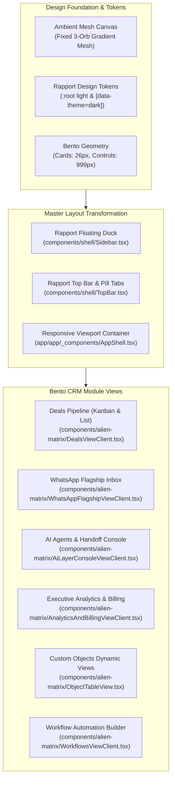
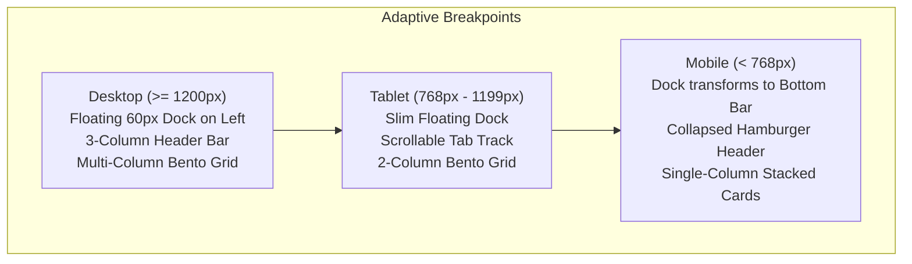

# CRM-to-Rapport UI Migration Blueprint
**Document:** `docs/ui-redesign/CRM_TO_RAPPORT_MAPPING.md`  
**Date:** October 25, 2026  
**Auditor:** Senior Software Architect & Frontend Reverse Engineering Specialist  
**Inputs:** `PROJECT_AUDIT.md`, `ROUTE_INVENTORY.md`, `RAPPORT_UI_AUDIT.md`, `RAPPORT_DESIGN_TOKENS.md`  
**Status:** Task 3 Deliverable (Awaiting Approval for Day 4 Execution)

---

## 1. Executive Summary & Design System Architecture

This blueprint defines the comprehensive, route-by-route and component-by-component migration plan to re-skin **AlienMatrix CRM** with the **Rapport CRM** aesthetic in both **Light and Dark themes**.

### Core Tenet
**PRESENTATION LAYER TRANSFORMATION ONLY.**  
All underlying business logic, state machines, API endpoints (`/api/v1/alien-matrix/*`), Supabase RLS policies, realtime event log queues, WhatsApp connectors, AI gateway runtimes, and the 100% English translation catalog (`lib/i18n/traducoes/en.json`) remain strictly intact.



---

## 2. Master Layout Transformation

### 2.1 Fixed Ambient Mesh Background (`MeshCanvas`)
- **Injection Site**: `app/app/layout.tsx` (wrapped around `AppShell`) and `app/(public)/layout.tsx`.
- **Structure**:
  ```tsx
  <div className="mesh" aria-hidden="true">
    <i className="mesh__a" />
    <i className="mesh__b" />
    <i className="mesh__c" />
  </div>
  ```
- **Light Theme Behavior**: Renders soft warm peach (`#f2d3bd`), sage/mint (`#cfdfcd`), and pale butter (`#f1e4bf`) orbs with 60px Gaussian blur over the sand canvas (`#ebe8e1`).
- **Dark Theme Behavior**: Renders deep terracotta (`rgba(200,67,31,0.28)`), deep pine green (`rgba(47,92,80,0.50)`), and faint gold sheen over the forest charcoal canvas (`#111412`).

### 2.2 Floating Vertical Dock (`components/shell/Sidebar.tsx`)
- **Existing**: Collapsible vertical bar attached to the left edge of the screen.
- **Rapport Transformation**:
  - Detached, vertically centered floating pill dock:
    ```css
    position: fixed;
    top: 0;
    bottom: 0;
    left: max(20px, calc((100vw - 1840px)/2 + 20px));
    margin: auto 0;
    width: 60px;
    height: fit-content;
    border-radius: 999px;
    padding: 8px;
    z-index: 30;
    ```
  - **Light Theme**: Solid ink black surface (`#17191a`), floating elevation shadow `0 20px 40px -18px rgba(0,0,0,0.45)`.
  - **Dark Theme**: Frosted glass surface (`rgba(255,255,255,0.08)`), subtle hairline border `1px solid var(--line)`.
  - **Buttons**: Circular touch targets (`44px x 44px`, `50%` radius). Hover opacity elevates from `0.74` to `1.0` with `rgba(255,255,255,0.12)` background.
  - **Active State**: 5px butter-yellow indicator dot (`--butter: #f2c94c`) on the right margin.
  - **Tooltips**: Floating pill tooltip with keyboard shortcuts (`kbd`), sliding out at `left: calc(100% + 14px)`.
  - **Bottom Dock Controls**: Theme toggle button (animating Moon and Sun icons) that directly triggers `setTheme()` from `lib/theme.tsx`.

### 2.3 Top Bar & Pill Navigation (`components/shell/TopBar.tsx`)
- **Existing**: Full-width header bar with search bar and icon buttons.
- **Rapport Transformation**:
  - 3-column CSS Grid: `grid-template-columns: auto 1fr auto; align-items: center; gap: 20px; margin-bottom: 26px;`
  - **Column 1 (Brand Anchor)**:
    - Logo squircle (`brand__mark`): `38px x 38px`, `border-radius: 12px`, background `--pill`, text `--on-pill`.
    - Brand wordmark (`brand`): AlienMatrix brand text (`21px`, `font-weight: 700`, `letter-spacing: -0.02em`).
  - **Column 2 (Pill Navigation Track)**:
    - Horizontally centered pill tab navigation track (`border-radius: 999px; padding: 4px; background: transparent;`).
    - Active Tab: High-contrast solid pill (`background: var(--pill)`, `color: var(--on-pill)`) with smooth layout transition.
    - Inactive Tabs: Subtle text with hover well background (`background: var(--well)`).
  - **Column 3 (Quick Utilities)**:
    - Circular glass icon buttons (`40px x 40px`, `border-radius: 50%`, `background: var(--glass)`, `border: 1px solid var(--rim)`).
    - Global Search ⌘K trigger button.
    - Notification bell with tomato unread count indicator.
    - User avatar dropdown menu.

### 2.4 Content Canvas & Viewport Rules
- Main content container constrained to `max-width: var(--app-max)` (1840px), centered horizontally.
- Padding offset: Left margin respects dock position with `padding-left: clamp(80px, 6vw, 100px)`.
- Cards rendered inside responsive Bento grids with standard 16px gap (`--gap: 16px`).

---

## 3. Page-by-Page Mapping Specifications

Every active route identified in `ROUTE_INVENTORY.md` is mapped to its exact target Rapport visual pattern:

### 3.1 Core Dashboard & Analytics (`/app/analise/alien-matrix`)
* **Reference Pattern**: Rapport `#/overview` & `#/growth`.
* **Client View**: `AnalyticsAndBillingViewClient.tsx`.
* **Bento Grid Composition**:
  * **Card 1 (Hero Metric - Team Quota)**: Deep Pine Green surface (`--pine: #2f5c50`), white text, progress circular arc meter in butter yellow (`#f2c94c`), big number display (`44px`, `-0.03em` tracking).
  * **Card 2 (Revenue & Pipeline Trajectory)**: Translucent glass card with line chart in vermilion tomato (`--tomato: #c8431f`), subtle fill gradient, period filter pill buttons.
  * **Card 3 (WhatsApp Omnichannel Volume)**: Bar chart showing incoming vs outgoing message distribution with status badges.
  * **Card 4 (AI vs Human Resolution Rate)**: Split donut chart comparing autonomous AI completions against human escalations.
  * **Card 5 (Lead Conversion Funnel)**: Horizontal stepped funnel bar chart with percentage conversion deltas.
  * **Card 6 (Scheduled Custom Reports)**: Compact table listing automated export subscriptions with delivery status pills.

### 3.2 Deals CRM Pipeline (`/app/crm/deals`)
* **Reference Pattern**: Rapport `#/pipeline`.
* **Client View**: `DealsViewClient.tsx`.
* **Bento Grid Composition**:
  * **Header Card**: Pipeline selector dropdown, aggregate value pill, "+ New Deal" primary pill button (`.btn--ink`), view mode toggle (Kanban vs Table).
  * **Kanban Board Layout**:
    * Columns represent deal stages (Lead In, Qualified, Proposal Sent, Negotiation, Won, Lost).
    * Column headers display stage title, count badge, and total column value (`12px`, `font-weight: 600`, `color: var(--muted)`).
    * Deal Cards: Translucent nested tiles (`--r-tile: 22px`), glass background, hover elevation, contact avatar initials, priority badge, and deal value.
  * **Table View Layout**: Sortable table with hover well rows, stage dropdown selector, and quick action drawer trigger.

### 3.3 WhatsApp Flagship Workspace (`/app/channels/whatsapp`)
* **Reference Pattern**: Rapport High-Density Bento Workspace.
* **Client View**: `WhatsAppFlagshipViewClient.tsx`.
* **Bento Grid Composition**:
  * **Left Bento Card (Connected Numbers & Queue)**: Multi-number pill switcher (WAHA QR sessions & Meta Cloud numbers), conversation search bar, conversation status tabs (All, Unread, Human Handoff, Waiting).
  * **Center Bento Card (Message Thread)**:
    * Contact info header with status badge and assign-to selector.
    * Real-time conversation stream with WhatsApp speech bubbles (incoming: `--solid` surface; outgoing: `--pill` surface).
    * Integrated voice note player with waveform visualization.
    * Bottom composer with audio recording trigger, canned responses picker, attachment uploader, and send pill button.
  * **Right Bento Card (Lead Conversion & Internal Notes)**:
    * Quick Lead Conversion drawer: one-click conversion of WhatsApp contact into a CRM Lead or Deal.
    * Private team notes tab with timestamps and author avatars.
    * CRM contact custom fields inspector.

### 3.4 Team Activities & Appointments (`/app/crm/calendar` & `/app/agenda`)
* **Reference Pattern**: Rapport `#/schedule`.
* **Client View**: `CalendarViewClient.tsx`.
* **Bento Grid Composition**:
  * **Top Toolbar**: Day/Week/Month segmented pill control, today shortcut button, team member filter pills.
  * **Interactive Calendar Card**: Bento container (`--r-card: 26px`), clean grid cells with subtle hairline borders, colored event chips matching team member palette.
  * **Event Modal**: Centered modal dialog (`#modal`, `border-radius: 26px`) for creating/editing meetings, assigning leads, and setting call reminders.

### 3.5 Invoicing & Billing Orders (`/app/crm/invoices` & `/app/settings/billing`)
* **Reference Pattern**: Rapport `#/finance`.
* **Client View**: `InvoicesViewClient.tsx` & `BillingSettingsViewClient.tsx`.
* **Bento Grid Composition**:
  * **Top Metrics Row**: 3 KPI bento cards: Total Invoiced, Outstanding Payments, Collected Revenue with currency formatting.
  * **Invoices Data Table**: Translucent table card with invoice number, client name, issue date, status badge (Paid: Pine green; Overdue: Tomato red; Pending: Butter yellow), and PDF/CSV export actions.
  * **Plan Subscription Card**: Subscription tier switcher (Free, Starter, Pro, Enterprise), monthly/annual toggle, usage progress bars against plan limits, and Stripe/Asaas billing portal link.

### 3.6 Autonomous AI Agents Console (`/app/ai/alien-matrix`)
* **Reference Pattern**: Rapport `#/projects` & AI Operations Suite.
* **Client View**: `AiLayerConsoleViewClient.tsx`.
* **Bento Grid Composition**:
  * **Personas Grid Card**: Active AI sales personas with model selection (Claude 3.5 Sonnet, GPT-4o, Gemini 2.0 Flash), prompt editor, and active status toggle.
  * **RAG Knowledge Base Card**: Document upload zone (PDF, TXT), vector indexing status badges, chunk count, and semantic test query bar.
  * **Safety Guardrails Card**: Tone sliders, prohibited phrase blacklist, and hallucination prevention thresholds.
  * **Human Handoff Queue Card**: Real-time table of conversations requiring human takeover with claim and resolve actions.

### 3.7 Custom Objects Engine (`/app/objects`)
* **Reference Pattern**: Rapport Generic Dynamic Table & Drawer.
* **Client View**: `ObjectTableView.tsx`, `ObjectKanbanView.tsx`, `RecordDrawer.tsx`.
* **Bento Grid Composition**:
  * **Schema Switcher Header**: Pill tabs switching dynamically between tenant-defined entities (e.g. Vehicles, Properties, Consultations).
  * **Dynamic Table Card**: Automatically renders custom fields (text, number, currency, date, relationship lookup) using Rapport table styling.
  * **Record Drawer (`#drawer`)**: 480px slide-over sheet displaying complete entity details, timeline, and associated records.

### 3.8 Workflow Automation Builder (`/app/crm/workflows`)
* **Reference Pattern**: Rapport Visual Flow Builder.
* **Client View**: `WorkflowsViewClient.tsx`.
* **Bento Grid Composition**:
  * **Left Panel**: Workflow triggers list (Deal Stage Changed, WhatsApp Inbound, Form Submitted, Record Created).
  * **Canvas Card**: Visual node graph connecting triggers, conditions, and action nodes with translucent glass surfaces and hairline connecting lines.
  * **Right Drawer**: Action configuration editor (Send WhatsApp template, assign user, create activity).

### 3.9 Platform SuperAdmin Suite (`/admin/alien-matrix` & `/admin/*`)
* **Reference Pattern**: Rapport High-Density Management Console.
* **Client View**: `SuperAdminViewClient.tsx` & `AdminDashboardView.tsx`.
* **Bento Grid Composition**:
  * Cross-tenant health metrics (Active tenants, system load, WAHA cluster status).
  * Filterable tenant organizations directory table with quota editor modals.
  * White-label branding editor with live theme preview.

### 3.10 Public & Authentication Surfaces (`/login`, `/signup`, `/onboarding/*`)
* **Reference Pattern**: Centered Frosted Glass Bento Card.
* **Client View**: `LoginForm.tsx`, `SignupForm.tsx`, `OnboardingWizard.tsx`.
* **Composition**:
  * Clean, distraction-free viewport with ambient mesh background.
  * Centered bento auth card (`width: 440px`, `border-radius: 26px`, `background: var(--glass)`, `border: 1px solid var(--rim)`, `box-shadow: var(--shadow-pop)`).
  * Brand squircle mark, clear typography, pill input fields, and solid ink primary submit button.

---

## 4. UI Component Translation & Tokens Matrix

| Existing Component | File Path | New Rapport Visual Pattern | Token Mapping |
| :--- | :--- | :--- | :--- |
| **`Card`** | `components/ui/card.tsx` | `BentoCard` (`.card`) | `border-radius: 26px`<br/>`bg: var(--glass)`<br/>`border: 1px solid var(--rim)`<br/>`box-shadow: var(--shadow)` |
| **`Button`** | `components/ui/button.tsx` | `PillButton` (`.btn`) | `border-radius: 999px`<br/>`default: .btn--ink`<br/>`outline: .btn--ghost`<br/>`destructive: .btn--danger`<br/>`sm: .btn--sm` |
| **`Badge`** | `components/ui/badge.tsx` | `StatusBadge` (`.badge`) | `border-radius: 999px`<br/>`success: .badge--pine`<br/>`warning: .badge--butter`<br/>`destructive: .badge--tomato`<br/>`secondary: .badge--plain` |
| **`Table`** | `components/ui/table.tsx` | `RapportTable` (`.table`) | `border-collapse: separate`<br/>`th: font-size 12px, font-weight 600, color var(--muted)`<br/>`tr:hover: bg var(--well)` |
| **`Dialog`** | `components/ui/dialog.tsx` | `RapportModal` (`#modal`) | `border-radius: 26px`<br/>`bg: var(--solid)`<br/>`box-shadow: var(--shadow-pop)`<br/>`border: 1px solid var(--rim)` |
| **`Sheet`** | `components/ui/sheet.tsx` | `RapportDrawer` (`#drawer`)| `border-radius: 28px 0 0 28px`<br/>`bg: var(--solid)`<br/>`box-shadow: var(--shadow-pop)` |
| **`Sidebar`** | `components/shell/Sidebar.tsx`| `RapportDock` (`.dock`) | `width: 60px`<br/>`border-radius: 999px`<br/>`buttons: 44px round`<br/>`active: 5px butter dot` |
| **`TopBar`** | `components/shell/TopBar.tsx` | `RapportHeader` (`.top`) | `brand squircle: 38px`<br/>`tabs: centered pill track`<br/>`active tab: solid pill` |
| **`CommandPalette`** | `components/shell/CommandPalette.tsx` | `RapportFinder` (`#finder`) | `border-radius: 24px`<br/>`bg: var(--solid)`<br/>`box-shadow: var(--shadow-pop)` |
| **`DropdownMenu`** | `components/ui/dropdown-menu.tsx` | `RapportPopover` (`.pop-layer`) | `border-radius: 14px`<br/>`bg: var(--float)`<br/>`box-shadow: var(--shadow-pop)` |

---

## 5. Mobile & Responsive Adaptation Strategy



### 5.1 Responsive Dock Rules
* **Desktop (≥ 1200px)**: Floating pill vertical dock pinned at `left: max(20px, calc((100vw - 1840px)/2 + 20px))`.
* **Tablet (768px - 1199px)**: Compact dock remains visible, reducing gutter spacing to 16px.
* **Mobile (< 768px)**:
  * Dock hides from desktop layout (`hidden md:flex`).
  * Transforms into a sleek bottom navigation dock (`components/shell/BarraInferior.tsx`) styled with Rapport pill aesthetics and supporting iOS safe area insets:
    ```css
    padding-bottom: max(12px, env(safe-area-inset-bottom));
    ```

### 5.2 Header Adaptation
* **Desktop**: Full brand logo mark + wordmark + centered pill navigation tabs + quick utility buttons.
* **Mobile**: Compresses to brand squircle mark + page title dropdown + mobile hamburger drawer trigger.

### 5.3 Bento Grid Stacking Rules
* `grid-template-columns: repeat(12, 1fr)` on desktop.
* Hero cards span 8 or 12 columns.
* Secondary cards span 4 or 6 columns.
* Mobile forces all cards to `col-span-12`, rendering as a smooth, vertically stacked card feed.

---

## 6. Risk Management & Feature Preservation Checklist

To ensure absolute zero regression during Day 4, 5, and 6 implementation:

| Risk Area | Potential Failure Mode | Prevention & Verification Guard |
| :--- | :--- | :--- |
| **Theme Token Parity** | Dark mode token missing or named differently from light token | Enforced by `tests/unit/branding-tema-claro-escopavel.test.ts`. Every CSS token in `:root` and `[data-theme="light"]` must exist in `[data-theme="dark"]`. |
| **Whitelabel Compliance** | Accidental introduction of hardcoded brand strings | Enforced by `tests/unit/branding.test.ts`. Use `useMarcaDaInstalacao()` or `marcaDaSaida()`. |
| **Navigation Breakage** | Inaccessible page or missing navigation link | Enforced by `tests/unit/navegacao-completude.test.ts`. All routes must be registered in `lib/navigation/catalogo.ts`. |
| **Hydration Mismatch** | Theme flicker or mismatched server/client rendering | Use existing `useSyncExternalStore` in `lib/theme.tsx` and inline `THEME_INIT_SCRIPT` in `app/layout.tsx`. |
| **Form & API Degradation** | Breaking submit handlers or data structures | Components preserve exact props, state hooks, and Zod payload shapes. |
| **i18n Language** | Non-English text introduced | All labels must source from `lib/i18n/traducoes/en.json` via `useT()`. |

---

## 7. Execution Phases Roadmap (Days 4 - 7)

* **Day 4 — Master Layout & Global Primitives**:
  * Implement `MeshCanvas` in root/app layouts.
  * Re-skin `components/shell/Sidebar.tsx` into `RapportDock`.
  * Re-skin `components/shell/TopBar.tsx` into `RapportHeader` with pill tabs.
  * Re-skin core primitives (`card.tsx`, `button.tsx`, `badge.tsx`, `table.tsx`, `dialog.tsx`, `sheet.tsx`).
* **Day 5 — Core CRM & WhatsApp Flagship Views**:
  * Re-skin `DealsViewClient.tsx` (Kanban + Table).
  * Re-skin `WhatsAppFlagshipViewClient.tsx` (Flagship Inbox, Audio Player, Conversion Drawer).
  * Re-skin `CalendarViewClient.tsx` & `InvoicesViewClient.tsx`.
* **Day 6 — AI Operations, Analytics & Custom Objects**:
  * Re-skin `AnalyticsAndBillingViewClient.tsx`.
  * Re-skin `AiLayerConsoleViewClient.tsx`.
  * Re-skin `ObjectTableView.tsx`, `ObjectKanbanView.tsx`, `RecordDrawer.tsx`, and `WorkflowsViewClient.tsx`.
* **Day 7 — End-to-End Verification & Evidence Capture**:
  * Run full test suite (`pnpm test:unit`, `pnpm typecheck`).
  * Capture full before/after screenshot comparisons.
  * Commit and push to repository.
