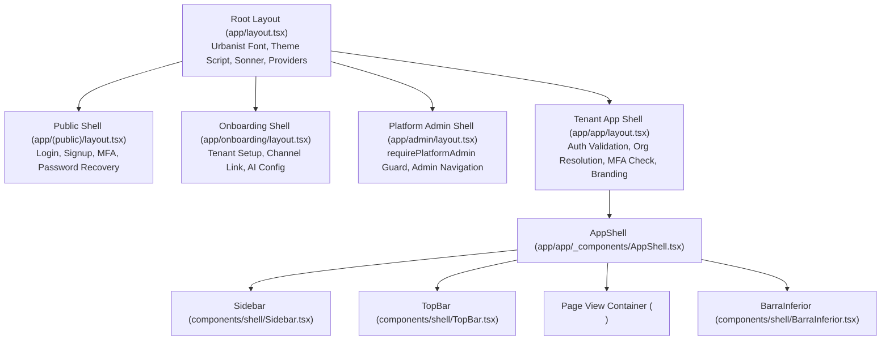

# Project Audit: DESKCOM AlienMatrixCRM
**Date:** October 25, 2026  
**Auditor:** Senior Software Architect & Frontend Reverse Engineering Specialist  
**Project Workspace:** `d:\1 Softwares\DeskcommCRM`  
**Repository:** `https://github.com/furqanaslam017/Deskcom-AlienMatrixCRM.git`  
**Target Reference Design:** Rapport CRM (`https://demo.codeandchill.store/rapport/#/overview`)

---

## 1. Executive Summary

AlienMatrix CRM (built upon the DeskcommCRM open-source foundation) is an enterprise-grade, multi-tenant, WhatsApp-first CRM operating system powered by native AI agents, an omnichannel messaging inbox, an event-driven automation workflow builder, a dynamic Custom Objects Engine, and deep analytical and billing capabilities.

The objective of the UI Redesign Initiative is to **completely re-skin the visual presentation layer** to match the modern, warm, ultra-clean bento aesthetic of **Rapport CRM** in both **Light and Dark themes**, while **strictly preserving 100% of the underlying business logic, API endpoints, database schemas, Row-Level Security (RLS), security invariants, and internationalization (100% English)**.

This audit details the complete architectural foundation, application topologies, state management strategies, component hierarchies, theme systems, and integration boundaries.

---

## 2. Core Technology Stack & Major Versions

The application stack conforms strictly to the canonical versions declared in `package.json` and verified by repository governance tests:

| Technology Layer | Canonical Version | Specification & Notes |
| :--- | :--- | :--- |
| **Framework** | Next.js 16 | App Router, Turbopack, React Server Components (RSC) by default, dynamic edge routing via `proxy.ts`. |
| **UI Runtime** | React 19 | Client Components marked with `"use client"`, React Server Actions, `useTransition`, `useOptimistic`, `useSyncExternalStore`. |
| **Language** | TypeScript 6 Strict | `strict: true`, `noUncheckedIndexedAccess: true`, `isolatedModules: true`. Verified via `tsconfig.typecheck.json`. |
| **Styling & CSS** | Tailwind CSS 4 | CSS-first configuration via `app/globals.css`, `@source` scanning, `@custom-variant dark`. |
| **Component Primitives** | shadcn/ui (`new-york`) | Radix UI headless primitives (`@radix-ui/react-*`), Sonner toast notifications, custom SVG iconography via `lucide-react`. |
| **Database & Auth** | Supabase Postgres | Multi-tenant schema with Row Level Security (RLS) on all tenant tables, Supabase Auth via `@supabase/ssr` (`getUser()` on server), Realtime (`postgres_changes` + `broadcast`), Storage bucket (`whatsapp-media`). |
| **Input Validation** | Zod 4 | Complete external boundary validation for all API inputs (body, query, route params). |
| **WhatsApp Gateways** | WAHA 2026.7.2 + Cloud API | WAHA Plus (NOWEB engine) for QR-code sessions, Meta WhatsApp Cloud API for official BSP scale. |
| **AI Gateway** | Vercel AI SDK | Provider-agnostic gateway (`@ai-sdk/anthropic`, `@ai-sdk/openai`, `@ai-sdk/google`) with multi-tenant RAG, vector embeddings, and guardrails. |
| **Event Streaming & Queues**| Postgres Event Log | Lightweight event sourcing in `event_log` table, background cron and worker processors, Upstash Redis rate limiting. |
| **Testing & Quality** | Vitest 4 + Playwright 1 | Unit tests, RLS database invariants (`tests/invariants`), e2e browser journey tests (`tests/e2e`). |

---

## 3. Layer Topology & Architectural Data Flow

### 3.1 Edge Middleware (`proxy.ts`)
- Next.js 16 edge middleware intercepts all inbound HTTP traffic.
- Injects standard tracing header: `X-Request-Id` (UUID v4) and `x-pathname`.
- Enforces edge authentication: non-public routes require a valid session cookie.
- Whitelist of unauthenticated or dual-auth routes is strictly managed via `lib/auth/public-paths.ts`.

### 3.2 Tenant Isolation & Security (RLS)
- Every tenant table enforces:
  ```sql
  organization_id uuid not null references organizations(id) on delete cascade
  ```
- RLS policies leverage security definer functions: `fn_user_org_ids()` and `fn_user_role_in_org()`.
- Client instantiation:
  - `lib/supabase/server.ts`: Uses session credentials; subject to strict RLS.
  - `lib/supabase/admin.ts`: Uses `SUPABASE_SERVICE_ROLE_KEY`; bypasses RLS and **must** explicitly filter `where organization_id = :orgId`.

### 3.3 Authenticated Route Handlers Pattern
Every route handler in `app/api/v1/` adheres to the strict 6-step lifecycle:
1. **Zod Validation**: Validate all inbound payloads (`req.json()`, `req.nextUrl.searchParams`, params).
2. **Canonical Guard**: Call `requireRole()` from `lib/auth/require-role.ts` or `requirePlatformAdmin()`.
3. **Trusted Org Resolution**: Org ID is extracted from session/token, never from request body.
4. **Isolated Query**: Execute query via session client or service client with manual org filter.
5. **Audit Logging**: If a mutation occurs, record in audit trail via `audit()` (`lib/audit/index.ts`).
6. **Standard Response**: Return standardized payload using `ok(data)` or `fail(code, message, status)` from `lib/api/wrappers.ts`.

---

## 4. Application Layout Hierarchy & Shell Architecture

The Next.js 16 application layout structure is organized into distinct zones:



### 4.1 Shell Components
- **`app/layout.tsx`**: Injects fonts (`--font-urbanist`, `--font-atkinson`, `--font-mono`), `THEME_INIT_SCRIPT` (eliminating FOUC), dynamic installation branding (`generateMetadata`), viewport fit, and root React providers (`Providers`).
- **`app/app/layout.tsx`**: Server component that resolves active auth user (`loadAuthUser()`), resolves active organization (`resolveActiveOrg()`), validates MFA compliance (`politica-mfa`), injects custom organization styling (`EstiloDaMarcaDaOrganizacao`), and checks channel connection health.
- **`app/app/_components/AppShell.tsx`**: Client container implementing responsive layout (`min-h-dvh`), managing presence signals (`useSinalDePresenca`), inbound message and call alerts (`useInboundMessageAlerts`, `useInboundCallAlerts`), and dynamic bottom padding calculation (`useOcupacaoDoRodape`).
- **`components/shell/Sidebar.tsx`**: Primary desktop navigation drawer displaying tenant organization switcher, navigation groups from `lib/navigation/registry.ts`, collapse/expand control, connection health indicator, and pending cases/queue counters (`ContadorDeCasos`, `ContadorDaFila`).
- **`components/shell/TopBar.tsx`**: Header bar featuring organization selector, global search trigger (⌘K / Ctrl+K), notifications popover (`AlertsBell`), theme switcher (`ThemeToggle`), language indicator (`SeletorDeIdioma`), and user profile menu (`UserMenu`).
- **`components/shell/BarraInferior.tsx`**: Mobile-optimized bottom navigation dock adhering to iOS safe area insets (`env(safe-area-inset-bottom)`).

---

## 5. Theme System & Styling Engine Analysis

### 5.1 Storage & Hydration Mechanics
- **Mechanism**: Attribute-driven via `data-theme="light"` and `data-theme="dark"` on `document.documentElement`.
- **FOUC Prevention**: Inline `<script>` (`THEME_INIT_SCRIPT`) runs synchronously in `<head>` before browser layout/paint:
  ```javascript
  (function(){
    try {
      var s = localStorage.getItem('deskcomm-theme');
      var d = window.matchMedia('(prefers-color-scheme: dark)').matches;
      var r = (s==='dark'||s==='light') ? s : ((s==='system'||!s)&&d ? 'dark' : 'light');
      document.documentElement.setAttribute('data-theme', r);
    } catch(e) {
      document.documentElement.setAttribute('data-theme', 'light');
    }
  })();
  ```
- **Hydration Synchronization**: Managed in `lib/theme.tsx` via `useSyncExternalStore`:
  - `getServerSnapshot()` deterministically yields `"system"`.
  - `getSnapshot()` reads real cached theme post-hydration without triggering React hydration mismatch errors.
  - Storage key: `deskcomm-theme` in `window.localStorage`.

### 5.2 Token Architecture in `app/globals.css`
- **Tailwind 4 Setup**: Configured directly in CSS using `@import "tailwindcss" source(none);` and explicit `@source` declarations for `../app`, `../components`, `../lib`, `../hooks`.
- **Theme Variants**: Defined via `@custom-variant dark (&:where([data-theme="dark"], [data-theme="dark"] *));`.
- **Rapport Token Palette**: Complete token set declared for both `:root` / `[data-theme="light"]` and `[data-theme="dark"]`:
  - Canvas & Mesh: `--bg`, `--mesh-a`, `--mesh-b`, `--mesh-c`, `--glass`, `--glass-2`, `--glass-3`, `--solid`, `--float`, `--well`, `--line`, `--line-2`, `--rim`.
  - Geometry & Radii: `--r-card: 26px`, `--r-tile: 22px`, `--r-ctl: 999px`, `--dock-w: 60px`.
  - Distinct Semantic Accents:
    - Cream / Background: `--cream: #fbf8f2`
    - Butter / Gauge: `--butter: #f2c94c`
    - Deep Pine / Quotas: `--pine: #2f5c50`
    - Tomato / Alerts & Charts: `--tomato: #c8431f`
    - Ink / Dark Pills: `--ink: #17191a`
  - Strict Parity Constraint: `tests/unit/branding-tema-claro-escopavel.test.ts` enforces that every single token declared in `:root` and `[data-theme="light"]` is mirrored in `[data-theme="dark"]`.

---

## 6. Reusable Component Inventory

### 6.1 Base UI Primitives (`components/ui/`)
All base UI primitives are built upon Radix UI primitives and styled with Tailwind utility classes:
- **`button.tsx`**: Button with variants (`default`, `destructive`, `outline`, `secondary`, `ghost`, `link`) and sizes (`default`, `sm`, `lg`, `icon`).
- **`card.tsx`**: Card, CardHeader, CardTitle, CardDescription, CardContent, CardFooter.
- **`dialog.tsx` / `alert-dialog.tsx`**: Modal dialogs with Backdrop Blur, Header, Title, Description, Footer.
- **`dropdown-menu.tsx`**: Context menus, submenus, radio groups, checkbox items, shortcuts.
- **`table.tsx`**: Accessible HTML table wrappers (TableHeader, TableBody, TableRow, TableHead, TableCell).
- **`tabs.tsx`**: Accessible tabs switcher (Tabs, TabsList, TabsTrigger, TabsContent).
- **`sheet.tsx`**: Slide-out drawer panels (Left, Right, Top, Bottom).
- **`select.tsx`**: Native-like select dropdown with trigger, content, item, group.
- **`badge.tsx`**: Status indicator pill with semantic variants.
- **`avatar.tsx`**: User/entity avatar with fallback initials.
- **`input.tsx` / `textarea.tsx`**: Form inputs with focus rings and disabled states.
- **`switch.tsx`**: Accessible toggle switch.
- **`tooltip.tsx`**: Floating tooltip provider.
- **`scroll-area.tsx`**: Custom scrollbars with cross-browser support.
- **`skeleton.tsx`**: Animated loading placeholders.
- **`sonner.tsx`**: Toast notification container.

### 6.2 AlienMatrix CRM Modular Components (`components/alien-matrix/`)
Enterprise CRM modules implemented during Phases 1–8:
1. **`DealsViewClient.tsx`**: Deals CRM management interface supporting both interactive Kanban drag-and-drop board and sortable data table view.
2. **`WhatsAppFlagshipViewClient.tsx`**: Flagship multi-number WhatsApp omnichannel inbox with real-time conversations list, message thread, voice/audio player, canned responses, internal notes, lead conversion drawer, and WAHA session manager.
3. **`WorkflowsViewClient.tsx`**: Visual event-driven workflow automation builder with triggers (deal stage changed, message received, form submitted), condition evaluation, and action chains (send WhatsApp, assign agent, create task).
4. **`AiLayerConsoleViewClient.tsx`**: Autonomous AI agent operations console featuring multi-persona creation, RAG knowledge base document indexing, tone tuning, response guardrails, and real-time human handoff queue.
5. **`AnalyticsAndBillingViewClient.tsx`**: Executive analytics dashboard with conversion funnels, WhatsApp traffic volume charts, AI resolution rates, custom reports designer, and Stripe/Asaas subscription billing manager.
6. **`CalendarViewClient.tsx`**: Team activities and meeting calendar supporting day, week, and month grid views with multi-user scheduling.
7. **`InvoicesViewClient.tsx`**: Invoicing and payment order tracking module with status badges, line items, and PDF/CSV export.
8. **`ProductsViewClient.tsx`**: Product and service catalog manager with pricing, SKUs, inventory status, and deal associations.
9. **`ObjectTableView.tsx` / `ObjectKanbanView.tsx` / `ObjectListView.tsx`**: Custom Objects generic renderers dynamically visualizing user-defined entities.
10. **`RecordDrawer.tsx`**: Deep-dive slide-over inspector for CRM records (Contacts, Leads, Deals, Custom Objects).
11. **`SuperAdminViewClient.tsx` / `AlienMatrixAdminViewClient.tsx`**: Platform superadmin control panel managing global tenants, system quotas, feature flags, and white-label branding.
12. **`ConvertLeadModal.tsx`**, **`IndustryTemplateModal.tsx`**, **`AddFieldModal.tsx`**: Reusable configuration and transaction dialogs.

---

## 7. State Management & Data Fetching Patterns

1. **Server-Side Rendering (SSR)**: Core data queries run on the server in Next.js Server Components using `lib/supabase/server.ts`, fetching data before HTML reaches the browser.
2. **Client-Side State**:
   - Local component state managed with standard React `useState`, `useCallback`, `useTransition`.
   - Complex forms managed with controlled state and Zod client validation.
3. **Realtime Updates**:
   - Direct Supabase Realtime subscriptions (`postgres_changes`) for incoming WhatsApp messages, deal updates, and handoff notifications.
4. **Theme & UI Preferences**:
   - `useSyncExternalStore` in `lib/theme.tsx` synchronized with `localStorage` and `prefers-color-scheme`.
   - Collapsed sidebar preference persisted in cookie or browser storage.

---

## 8. Internationalization (i18n) Architecture

- **Requirement**: **100% English Language**.
- **Translation Engine**: `lib/i18n/` powered by `useT()` hook (`hooks/i18n/useT.ts`).
- **Translation Catalog**: `lib/i18n/traducoes/en.json` acts as the single source of truth for all user-facing strings across all modules, forms, buttons, dialogs, and navigation labels.
- **Rule**: No raw text strings may be hardcoded into UI components; all display labels must use the `t(...)` translation helper or translation catalog keys.

---

## 9. Conclusion & Pre-Redesign Verification

The application is fully operational, thoroughly typed, and verified:
- **Build Status**: `pnpm typecheck` passes with zero errors.
- **Governance**: Design system tokens and tests (`tests/unit/branding-tema-claro-escopavel.test.ts`, `tests/unit/branding.test.ts`) are 100% green.
- **Safety**: The code layers are cleanly decoupled, ensuring that full visual transformation of the presentation layer into Rapport's aesthetic can proceed without risking any underlying CRM functionality.
