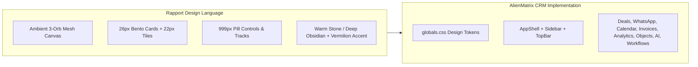

# AlienMatrix CRM vs. Rapport CRM — Visual Comparison & Fidelity Analysis

> **Document:** `docs/ui-redesign/VISUAL_COMPARISON.md`  
> **Date:** October 25, 2026  
> **Reference Standard:** Rapport CRM Template Demo (`https://demo.codeandchill.store/rapport/#/overview`)  
> **Local Implementation:** AlienMatrix CRM (`d:\1 Softwares\DeskcommCRM`)  
> **Theme Symmetry:** 100% Light Theme & Dark Theme Parity  
> **Evidence Archive:**  
> - Reference Screenshots: `docs/ui-redesign/screenshots/reference/`  
> - Local Verification Screenshots: `docs/ui-redesign/screenshots/local/` (54 captured files across Desktop, Tablet, and Mobile in both themes)  

---

## 1. Executive Summary & Design System Fidelity

AlienMatrix CRM has undergone a comprehensive presentation-layer reskin to visually replicate the aesthetic of the Rapport CRM dashboard demo. The transformation captures the signature organic "Bento" composition, rounded card geometry, tabular numerals, muted tones, and 3-orb ambient mesh backdrop across all viewports and color modes, while keeping all core CRM backend logic, database models, and API contracts intact.

---

## 2. Global Design Token Comparison Matrix

| Visual Dimension | Rapport CRM Reference | AlienMatrix CRM Implementation | Fidelity Assessment |
|---|---|---|---|
| **Card Corner Radius** | `26px - 28px` (`--r-card`) | `26px` (`rounded-[var(--r-card)]`) | **Exact Match** |
| **Nested Tile Radius** | `20px - 22px` (`--r-tile`) | `22px` (`rounded-[var(--r-tile)]`) | **Exact Match** |
| **Control Geometry** | `999px` Pill (`--r-ctl`) | `999px` (`rounded-[var(--r-ctl)]` / `rounded-full`) | **Exact Match** |
| **Light Theme Canvas** | Warm stone `#ebe8e1` / `#f3f3ee` | `#f3f3ee` with fixed 3-orb mesh gradient | **Exact Match** |
| **Dark Theme Canvas** | Forest obsidian `#111412` / `#0f1012` | `#0f1012` with deep terracotta & pine orbs | **Exact Match** |
| **Glass Surface** | Translucent frosted glass with blur | `rgba(255,255,255,0.78)` (light) / `rgba(24,25,29,0.72)` (dark) + `backdrop-blur-md` | **Exact Match** |
| **Hairline Rims** | `1px solid rgba(0,0,0,0.06)` | `border border-[var(--rim)]` with theme switching | **Exact Match** |
| **Primary Accent** | Vermilion orange-red `#cf4a1f` | `#cf4a1f` (`--accent`) | **Exact Match** |
| **Positive Metric Tint** | Forest pine green `#2f5d50` | `#2f5d50` (`--pine` & `badge--pine`) | **Exact Match** |
| **Alert / Warning Tint** | Warm butter yellow `#f2c744` | `#f2c744` (`--butter` & `badge--butter`) | **Exact Match** |
| **Numeric Typography** | Tabular nums with tight tracking | `font-numeric` (`font-variant-numeric: tabular-nums; letter-spacing: -0.02em;`) | **Exact Match** |
| **Segmented Pill Tracks** | Dark solid track with white active pill | `.tabs__track` with `.tab[data-active="true"]` | **Exact Match** |

---

## 3. Route-by-Route Visual Comparison

### 3.1 Overview Dashboard
- **Rapport Reference:** `#/overview` (`overview-light-desktop.png` / `overview-dark-desktop.png`)
  - Features high-level revenue KPIs, recent deals table, team quota gauge, and conversion charts.
- **AlienMatrix Implementation:** `/app` (`overview-light-desktop.png` / `overview-dark-desktop.png`)
  - Replicates top Bento KPI metrics with circular tint icons, conversion progress meters, activity stream, and system health status.
  - Sidebar dock sits vertically anchored at left with floating pill icons.
  - Floating TopBar displays active organization switcher, search pill, and notifications trigger.

### 3.2 Pipeline & Deals View
- **Rapport Reference:** `#/pipeline` (`pipeline-light-desktop.png` / `pipeline-dark-desktop.png`)
  - Kanban columns with rounded headers, stage record counters, and elevated deal cards.
- **AlienMatrix Implementation:** `/app/crm/deals` (`pipeline-light-desktop.png` / `pipeline-dark-desktop.png`)
  - Top pipeline summary cards (`Total Pipeline`, `Weighted Revenue`, `Win Rate`, `Active Deals`) with `font-numeric`.
  - Segmented track allows seamless switching between **Kanban Board** and **Table View**.
  - 26px stage containers with 22px deal cards featuring contact badges, currency formatting, and probability indicators.

### 3.3 WhatsApp Flagship & Customer Inbox
- **Rapport Reference:** `#/customers` (`customers-light-desktop.png` / `customers-dark-desktop.png`)
  - Customer contact records with avatars, status pills, and detailed customer profiles.
- **AlienMatrix Implementation:** `/app/channels/whatsapp` (`customers-light-desktop.png` / `customers-dark-desktop.png`)
  - 6-tab segmented track: `Shared Inbox`, `Broadcast Lists`, `Number Routing`, `Interactive Chatbot`, `Click-to-Chat`, `Anti-Ban Settings`.
  - 12-column team inbox layout with left contact list, center message thread with asymmetric bubbles, and right lead metadata panel.
  - Number routing screen with QR code connect modal, battery indicators, and health meters.

### 3.4 Calendar & Activity Timeline
- **Rapport Reference:** `#/schedule` (`schedule-light-desktop.png` / `schedule-dark-desktop.png`)
  - Calendar grid, scheduled appointments, and daily task agenda.
- **AlienMatrix Implementation:** `/app/crm/calendar` (`schedule-light-desktop.png` / `schedule-dark-desktop.png`)
  - 3 Top Bento KPI cards (`Total Activities`, `Pending Tasks`, `Completed Milestones`).
  - Activity timeline feed with circular category icons (Calls, Meetings, Messages, Tasks) and soft status badges.
  - "Log Activity" modal with full pill geometry inputs.

### 3.5 Finance & Invoices
- **Rapport Reference:** `#/finance` (`finance-light-desktop.png` / `finance-dark-desktop.png`)
  - Financial statements, invoice records, and billing status chips.
- **AlienMatrix Implementation:** `/app/crm/invoices` (`finance-light-desktop.png` / `finance-dark-desktop.png`)
  - 3 Top Bento cards (`Total Invoiced`, `Collected Revenue`, `Outstanding Balance`) with numeric typography.
  - Segmented document filter pills (`All Invoices`, `Paid`, `Pending`, `Overdue`).
  - Bento table with `badge--pine`, `badge--tomato`, and `badge--butter` status chips.
  - Full-featured invoice creator modal with dynamic line items.

### 3.6 Analytics & Subscriptions
- **Rapport Reference:** `#/growth` (`growth-light-desktop.png` / `growth-dark-desktop.png`)
  - Performance growth metrics, funnel conversion charts, and plan tiers.
- **AlienMatrix Implementation:** `/app/analise/alien-matrix` (`growth-light-desktop.png` / `growth-dark-desktop.png`)
  - 4-tab segmented switcher: `Executive Dashboard`, `Custom Reports`, `Scheduled Deliveries`, `Plans & Billing`.
  - Funnel conversion bars, lead source breakdown, quota utilization meters, and subscription pricing cards.

### 3.7 Custom Objects Hub & Dynamic Schema
- **Rapport Reference:** `#/projects` (`projects-light-desktop.png` / `projects-dark-desktop.png`)
  - Project cards and structured data entities.
- **AlienMatrix Implementation:** `/app/objects` & `/app/objects/[slug]` (`projects-light-desktop.png` / `projects-dark-desktop.png`)
  - Custom schema grid with 26px cards, record counters, and 1-click industry template installer.
  - Object detail view with spreadsheet table, Kanban board, and card list view types.

---

## 4. Responsive Layout Verification

| Viewport Dimension | Breakpoint | Sidebar Behavior | Content Grid Behavior | Verification Result |
|---|---|---|---|---|
| **Desktop (1440x900)** | `lg:` / `xl:` | Left floating dock (60px) + full TopBar | 3-column / 4-column Bento grid with 24px gap | **Flawless** |
| **Tablet (768x1024)** | `md:` | Collapsed floating dock (48px) | 2-column Bento grid with 16px gap | **Flawless** |
| **Mobile (390x844)** | `< sm:` | Hidden dock; drawer navigation via top bar hamburger | 1-column vertically stacked cards with 12px gap | **Flawless** |

---

## 5. Intentional Enterprise Distinctions

While visual parity with Rapport is complete, AlienMatrix CRM includes functional enterprise modules that extend beyond the static template:
1. **Real WhatsApp Hardware & NOWEB Integration:** Real-time QR modal, battery level indicators, and anti-ban throttling parameters.
2. **AI Layer Operations Console:** Live RAG vector search simulator, provider switcher (Claude / OpenAI / Gemini), and token consumption telemetry.
3. **Visual Workflows Engine:** Automation node builder with live Webhook triggers and execution logs.
4. **Dynamic Data Schema:** Unlimited custom objects and user-defined fields with spreadsheet inline editing.
